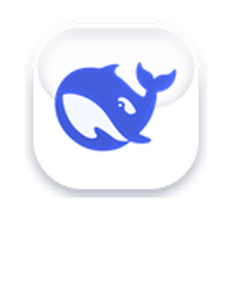
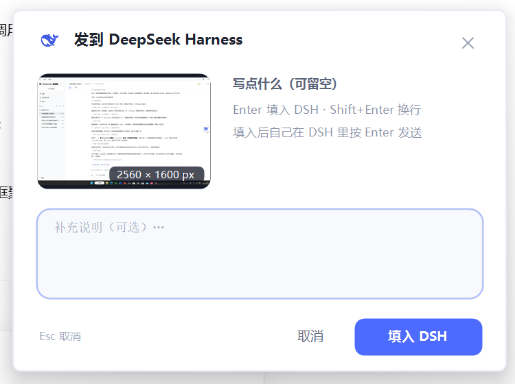

# 肥美小鲸鱼 🐳

桌面上的悬浮小鲸鱼：**点一下 → 框选 → 写两句话 → 直接进 DeepSeek Harness 的输入框**。
不用再手动截屏存文件、再拖进对话框。

纯本地运行：不联网、不写注册表、不装服务、不改系统设置——删掉文件夹就等于卸载。

**第一次用先看 [安装教程.md](安装教程.md)**：里面既有给人看的三步上手，也有一节可以让 AI 助手照着自动装。




## 运行要求

- Windows 10 / 11 桌面环境。
- **Windows PowerShell 5.1**，通常由系统自带，程序名为 `powershell.exe`。PowerShell 7 的程序名是 `pwsh.exe`，不需要为本工具另行安装。
- DeepSeek Harness 后台已启动，并已打开可用的聊天窗口；只有后台、没有窗口时无法填入。
- 保留完整文件夹，尤其是 `whale-shot.ps1` 和 `whale-input.ps1`，不要只下载主脚本。

`start.vbs` 会自动调用系统自带的 Windows PowerShell 5.1。路径中的 `WindowsPowerShell\v1.0` 是系统目录名，不代表版本为 1.0。

## 怎么用

双击 `start.vbs`（没有黑框、没有控制台）。屏幕右侧中部会出现一只白卡小鲸鱼。

如果系统禁用了 VBS，可在工具文件夹中打开 PowerShell 终端，执行：

```powershell
& "$env:SystemRoot\System32\WindowsPowerShell\v1.0\powershell.exe" -NoProfile -STA -ExecutionPolicy Bypass -File ".\whale-shot.ps1"
```

这条命令也可从 PowerShell 7 终端执行，它会另起 Windows PowerShell 5.1 来运行工具。这里只为本次进程指定执行策略，不修改系统全局策略。

| 操作 | 效果 |
|---|---|
| **单击鲸鱼** | 全屏变暗，拖出一个白色边框的矩形 → 松手弹出面板 |
| **拖动鲸鱼** | 挪到别处（只在本次运行内有效） |
| **右键鲸鱼** | 框选截图 / 整屏截图 / 上次的图 / 退出 |
| **托盘图标** | 左键框选，右键菜单 |
| 面板里 **Enter** | 把「图片 + 你写的字」填进 DSH 输入框（**不发送**） |
| 面板里 **Shift+Enter** | 换行 |
| 面板里 **Esc** | 取消 |
| 拖动面板**头部** | 移动面板 |

填进去之后，**你自己看一眼，在 DSH 里按 Enter 发送**——这是故意的，避免误发。

面板右上角 `×` 关闭；缩略图右下角的 `1200 × 800 px` 是**这张截图**的尺寸，跟你的屏幕不一样是正常的。

想开机自启：见 [安装教程.md](安装教程.md) §7.5，可做可不做。

## 文件

```
肥美小鲸鱼/
├── start.vbs          无窗口启动器（双击这个）
├── whale-shot.ps1     主程序（球 / 框选 / 面板 / 写入 DSH）
├── whale-input.ps1    必需：独立进程识别和检查 DSH 聊天输入框
├── config.json        配置
├── README.md          使用说明
├── 安装教程.md         安装、自检、排障、卸载
├── 检查输入框.cmd       输入框诊断入口
├── 填入优化说明.md      填入行为和验证范围说明
├── LICENSE            MIT
├── .gitignore         忽略运行日志、截图历史和开发文件
├── assets/            悬浮球、面板、托盘图标
└── docs/              成品截图
```

运行后会自动创建 `shots/`（截图历史，默认保留 200 张）和 `whale-shot.log`（运行日志）。发布包不含使用记录，出问题先看日志。

## 配置 `config.json`

| 字段 | 含义 |
|---|---|
| `size` | 悬浮球画布大小，单位 DIP（150% 缩放下 69 → 104px） |
| `keep` | 截图历史保留张数 |
| `pasteDelayMs` | 贴图后等多久再打字（默认 450ms） |
| `targetSuffix` | 目标窗口标题的后缀（默认 `DeepSeek Harness`） |
| `hoverScale` | 预留，当前版本未生效 |

改完重启小鲸鱼生效。

## 出问题怎么办

先看 `whale-shot.log`。完整的排查表在 [安装教程.md](安装教程.md) §8，最常见的两个：

- **找不到 DSH 窗口**：DSH 没开，或者窗口标题变了。用 `-TestWindow` 确认，或改 `targetSuffix` 后重启。
- **切不到 DSH / 焦点没过来**：系统前台锁在拦，先手动点一下 DSH 输入框再试。
- **无法识别聊天输入框**：保持 DSH 打开，双击 `检查输入框.cmd`，查看诊断结果。
- **提示缺少 `whale-input.ps1`**：重新解压完整发布包，确认它与 `whale-shot.ps1` 在同一目录。

工具会先识别并检查 DSH 聊天输入框，再尝试填入；无法定位时会保留截图和备注。它**不会自动发送**，最后一步由你在 DSH 中确认并发送。

## 已知限制

- 只覆盖主屏，多屏未适配
- 球的位置不持久化，每次启动都在右侧垂直居中
- 悬停无放大反馈
- 选区内部和外部一样暗（还没做"挖亮"）

## 版本

`0.1` · 发布整理：2026-11-05 · MIT
